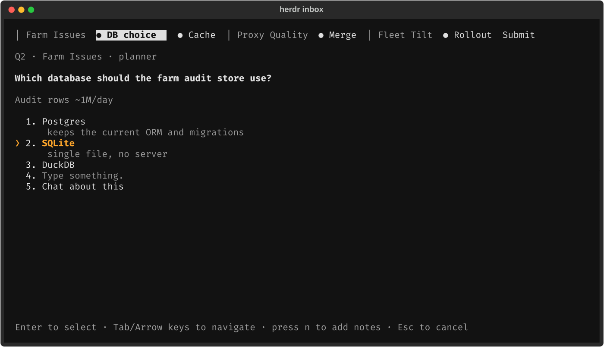
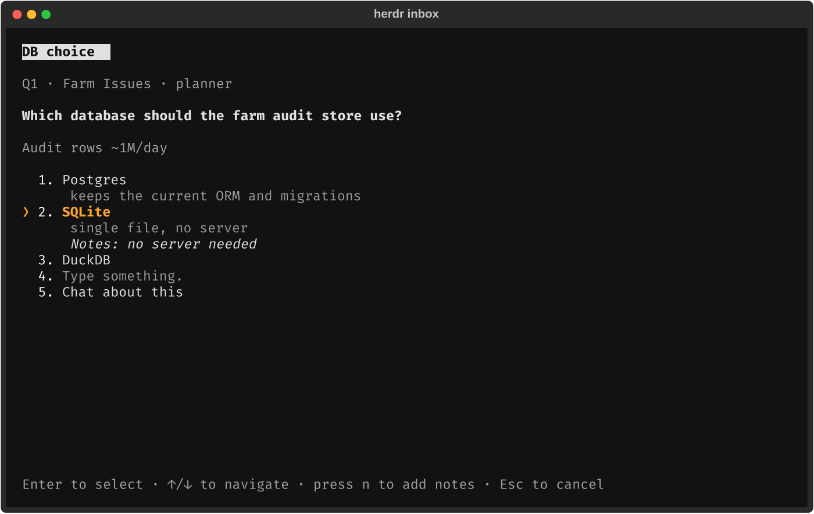
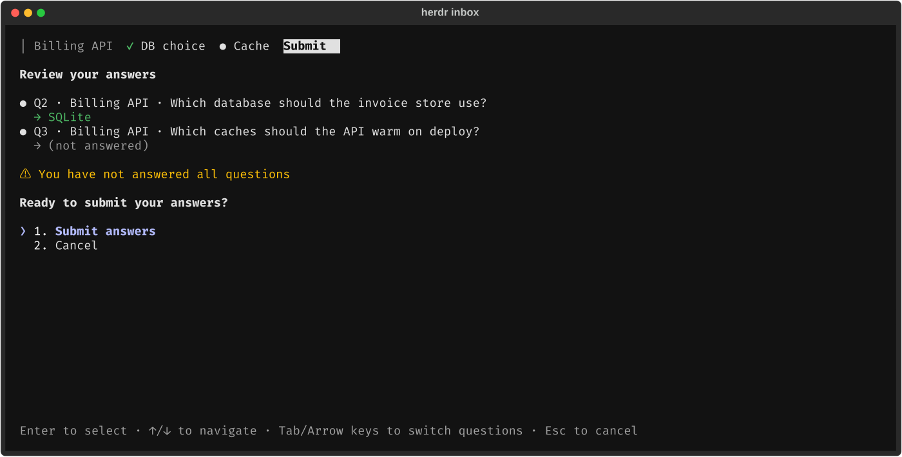
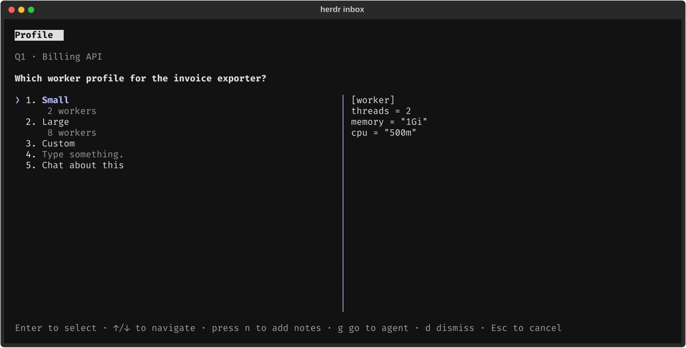
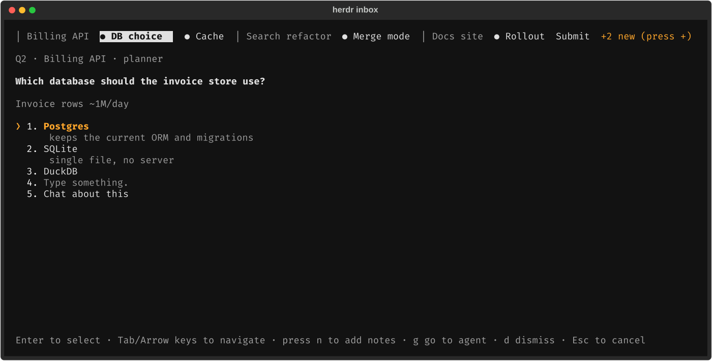

<div align="center">

# herdr inbox

### Ask once, keep working, answer from one popup.

A non-blocking question inbox for Claude Code agents running in
[herdr](https://herdr.dev): agents file a question through an MCP tool and carry on, you answer
every open question from a Claude-Code-style tabbed popup, and the answer is typed back into the
asking agent's pane.


<br><br>



</div>

When you run several agents in parallel, their questions get lost in chat, and an agent that
gets no answer repeats the question every few turns. A blocking dialog (`AskUserQuestion`) fixes
that by stopping the agent, which is also not what you want. herdr-inbox gives every question one
place: the agent calls `ask_operator` **once**, gets a receipt (`Q12`) and keeps working.

```sh
claude plugin marketplace add LeaveMyYard/herdr-inbox
claude plugin install herdr-inbox@herdr-inbox
herdr plugin install LeaveMyYard/herdr-inbox
```

The repo is two plugins at once: a **Claude Code plugin** (`.claude-plugin/`: MCP server, hooks,
the `herdr-inbox:operator-questions` skill) and a **herdr plugin** (`herdr-plugin.toml`: popup,
`open` and `sync-tokens` actions, startup hook). You install both.

## Answering

Press `prefix+i`. Every open question is a tab: first those from the pane you were in, then the
rest oldest first; a dim `│ <tab label>` marks where the next agent's questions start.

### One question

<div align="center">

</div>

With one open question, selecting an answer sends it and closes the popup. Options can be plain
strings or `{label, description, preview}`; there is always **Type something.** (a free answer; in
multi-select it is added to the picks) and **Chat about this** (jumps to the asking agent's pane
and leaves the question open). `n` adds a note to the highlighted option, e.g.
`Postgres (note: keep the old schema)`.

### Several questions and Submit

<div align="center">

</div>

With several open, answering drafts the question and moves on. The last tab, **Submit**, reviews
everything ("You have not answered all questions" when some are blank) and sends every answered
question at once, one message per pane; the rest stay open. Drafts are stored, so closing the
popup loses nothing. An agent can also file up to 4 related questions in one call
(`ask_operator(questions=[...])`); they stay adjacent.

### Option previews

<div align="center">

</div>

An option may carry a `preview` (plain monospace text such as a config snippet); it is shown beside
the list while that option is highlighted.

### Questions arriving while you answer

<div align="center">

</div>

Nothing that happens in the background changes what your next key does. New questions wait behind
a `+N new (press +)` marker so `Tab` keeps going where it went; `+` opens them. A question view
ignores Enter, digits and Space for 0.4 s after it appears. If the question on screen is closed
meanwhile (withdrawn, answered elsewhere) it becomes an inert "Q12 was closed" placeholder that
leaves when you switch tabs. With no open questions the popup shows "No open questions" and closes
on any key; a question arriving then is only announced. Answers that could not be delivered
appear as `⚠ Q12 not delivered` tabs with **Retry delivery** / **Stop showing it here** (the agent
can still fetch it with `check_answers`).

## Keys

| Key | Action |
|---|---|
| `↑` `↓` / `j` `k` | Move the `❯` cursor |
| `1`–`9` | Jump to that option |
| `Enter` | Select the option (single-select), toggle it (multi-select) |
| `Space` | Toggle (multi-select) |
| `n` / `x` | Add a note to the option / clear the draft |
| `Tab` `→` / `Shift-Tab` `←` | Next / previous tab |
| `+` | Show questions that arrived while the popup was open |
| `g` | Go to the asking agent's pane |
| `d` | Dismiss the current question (`y` confirms) |
| `Esc` | Close without sending |

## Delivery

An answer arrives in the agent's conversation as
`[inbox] Q12 answered — <question>: Postgres (note: keep the old schema)`, or for several
`[inbox] answered — Q12 <q>: A · Q13 <q>: B`, only while that pane still holds the conversation
that asked. If delivery fails (agent at a dialog, pane gone, conversation changed), the asking
session's MCP server retries every 30 s, and the agent can always fetch the answer itself.

## Tab marker and sidebar count

herdr has no per-tab tokens, so while a tab has open questions its label gets a `❓N ` prefix
(`herdr tab rename`), updated as the count changes and removed at 0:

```
Billing API        ->   ❓2 Billing API
```

Your own label is never stored: it is recovered by stripping the prefix each time, so renaming a
prefixed tab is respected. Tabs without a custom name (herdr shows their position, e.g. `6`) are
left alone by default, because a rename cannot give them back automatic naming.

Optionally, every pane with open questions carries the pane token `inbox_q = "?N"`, cleared when
the last one closes. Add `$inbox_q` to a row of the agent sidebar:

```toml
[ui.sidebar.agents]
rows = [["state_icon", "tab", { token = "$inbox_q", fg = "#c04a4a", bold = true }], ["agent"]]
```

If a tool such as herdr-radar manages `[ui.sidebar.agents]` for you, add the token entry to its
rows instead and re-add it after that tool rewrites them.

## Install

**Requirements:** herdr ≥ 0.9.0 (Linux or macOS); Claude Code with plugin support;
[`uv`](https://docs.astral.sh/uv/) on `PATH` for both herdr and Claude Code.

**Claude Code:**

```sh
claude plugin marketplace add LeaveMyYard/herdr-inbox
claude plugin install herdr-inbox@herdr-inbox
```

This registers the MCP server (tools appear as `mcp__plugin_herdr-inbox_herdr-inbox__ask_operator`
etc.) and the hooks. Restart running Claude sessions (or `/reload-plugins`). Claude Code installs
plugins as a copy, so the plugin keeps its Python environment in `${CLAUDE_PLUGIN_DATA}/venv`
(created by uv on first use, about 0.5 s from a warm cache). MCP server only, without hooks: run
`claude mcp add --scope user herdr-inbox -- uv run --project /path/to/herdr-inbox inbox mcp` from a
checkout and add [docs/agent-instructions.md](docs/agent-instructions.md) to your `CLAUDE.md`; use
one route, not both.

**herdr:**

```sh
herdr plugin install LeaveMyYard/herdr-inbox
```

herdr runs the manifest's `[[build]]` step (`uv sync --frozen --no-dev`) during install, after
showing you what it will run. Add `--ref <tag>` to pin a revision. Then bind a key in
`~/.config/herdr/config.toml` and run `herdr server reload-config`:

```toml
[[keys.command]]
key = "prefix+i"
type = "plugin_action"
command = "leavemyyard.herdr-inbox.open"
description = "question inbox"
```

## Configuration

Settings live in `config.toml` in the plugin's config directory
(`herdr plugin config-dir leavemyyard.herdr-inbox`):

```toml
tab_prefix = "❓"            # "" turns the tab prefix off
prefix_unnamed_tabs = false  # true: also prefix tabs named by position (they keep the number)
```

The popup and every Claude session read this file, and edits apply without a restart. The database
is `${XDG_STATE_HOME:-~/.local/state}/herdr-inbox/inbox.db`; `HERDR_INBOX_DB` overrides it.

## Agent tools

| Tool | Purpose |
|---|---|
| `ask_operator(question, options?, header?, multi_select?, context?, asked_by?)` | File a question (or `questions=[...]`, up to 4); returns a receipt immediately |
| `check_answers` | Answers not seen yet (after a missed delivery or compaction) |
| `list_my_questions(include_closed=false)` | The session's questions, to recover after `/compact` or `/clear` |
| `withdraw_question(id, reason)` | The agent resolved it itself |

A SessionStart hook teaches every Claude Code session to use them, so no `CLAUDE.md` edit is
needed. Outside herdr the hooks stay silent and `ask_operator` tells the agent to ask in chat.

From a shell (from a checkout, as `uv run inbox ...`):

```sh
inbox list [--all]
inbox answer Q12 "squash it"
inbox dismiss 12
inbox sync-tokens
```

## Updating

```sh
herdr plugin update                       # herdr side (or: herdr plugin update LeaveMyYard/herdr-inbox)
claude plugin marketplace update herdr-inbox
claude plugin update herdr-inbox@herdr-inbox
```

Then restart Claude sessions: a session started before the update keeps its old MCP server. While
0.2.x and 0.3 sessions overlap, an answer sent at the same moment as an old session's retry tick can
(rarely) be delivered twice; the window closes once every session has restarted.

## Uninstall

Remove the tab prefixes first (pane tokens vanish with herdr's next restart). Set
`tab_prefix = ""` in the config file above, then reconcile every tab:

```sh
herdr plugin action invoke leavemyyard.herdr-inbox.sync-tokens
```

Then remove the plugins:

```sh
herdr plugin uninstall leavemyyard.herdr-inbox       # or: herdr plugin unlink ... if you linked it
claude plugin uninstall herdr-inbox@herdr-inbox
claude plugin marketplace remove herdr-inbox
```

From a checkout, `uv run inbox sync-tokens --remove-prefixes` does the first step in one command.
Remove the `prefix+i` binding yourself. The database stays in `~/.local/state/herdr-inbox/`
until you delete it.

## How it works

The MCP server (spawned per Claude session, so it inherits the pane's `HERDR_PANE_ID`) writes
questions to a shared SQLite database. The popup reads it, and answering calls
`herdr agent prompt <pane>`. Markers use `herdr tab rename` and `herdr pane report-metadata`. A
SessionStart hook injects a short usage block into each session. Details, data model and
design decisions: [docs/DESIGN.md](docs/DESIGN.md).

## Limitations and known issues

- **Proof of concept.** Interfaces may change. Claude Code only; other agents are not supported.
- Answers are **typed into the pane**, so one that arrives while you are typing in that pane can
  merge with your input. Retries are skipped while the pane is focused or the agent is blocked, but
  the first delivery from the popup has no such guard.
- A delivery whose `agent prompt` call times out after herdr already submitted it is retried, so
  the agent can receive that answer twice.
- After `/clear`, a restart or another agent taking over the pane, an answer is **not** typed
  anywhere (`conversation changed`); the agent gets it through `check_answers`.
- herdr has no compare-and-set rename, so a tab rename of yours landing in the few milliseconds
  between our read and our rename is overwritten.
- If a pane moves to another tab, the old tab's prefix is refreshed at the next `sync-tokens`.
- Subagents are not identified (use `asked_by`), and answers go to the main session's pane.
- Outside herdr, or from a `claude` nested inside an agent's pane, nothing is filed and the agent
  is told to ask in chat.
- No blocking questions, remote or mobile answering, or multi-machine sync.

## Development

```sh
uv sync
uv run pytest
```

Tests never touch a real herdr: they point `HERDR_BIN_PATH` at a fake that records its argv and
`HERDR_INBOX_DB` at a temp file. CI runs them on Linux and macOS, and validates the plugin
manifests with `claude plugin validate`. Keep the version identical in `pyproject.toml`,
`herdr-plugin.toml`, `.claude-plugin/plugin.json` and `.claude-plugin/marketplace.json` (a test
checks this); bump it for every release, since Claude Code keys its plugin cache by version.
Regenerate screenshots with `uv run pytest tests/make_screenshots.py` (needs `rsvg-convert`).

<div align="center">
<sub>MIT licensed. Screenshots are rendered headlessly from demo data.</sub>
</div>
