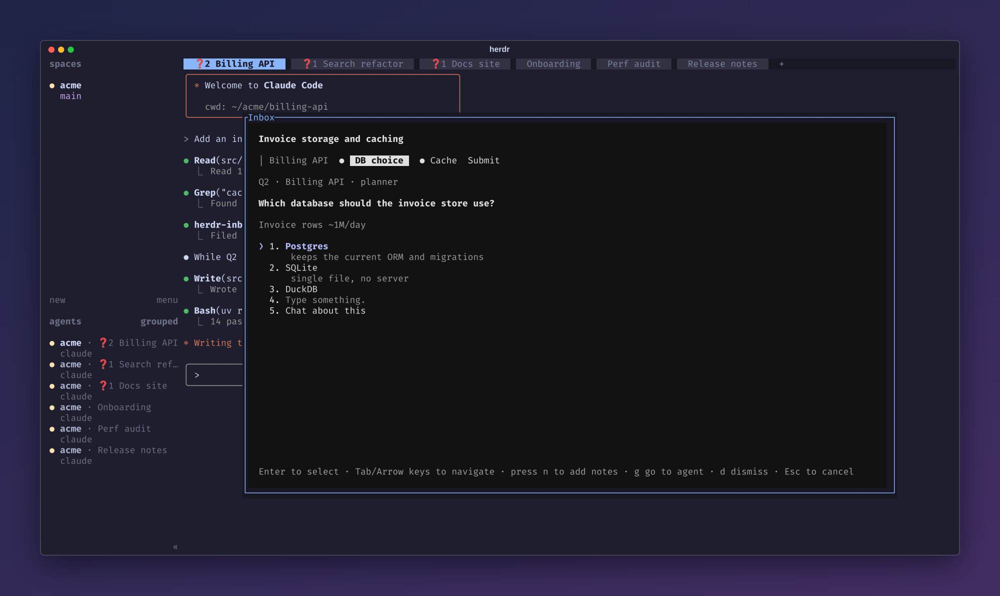
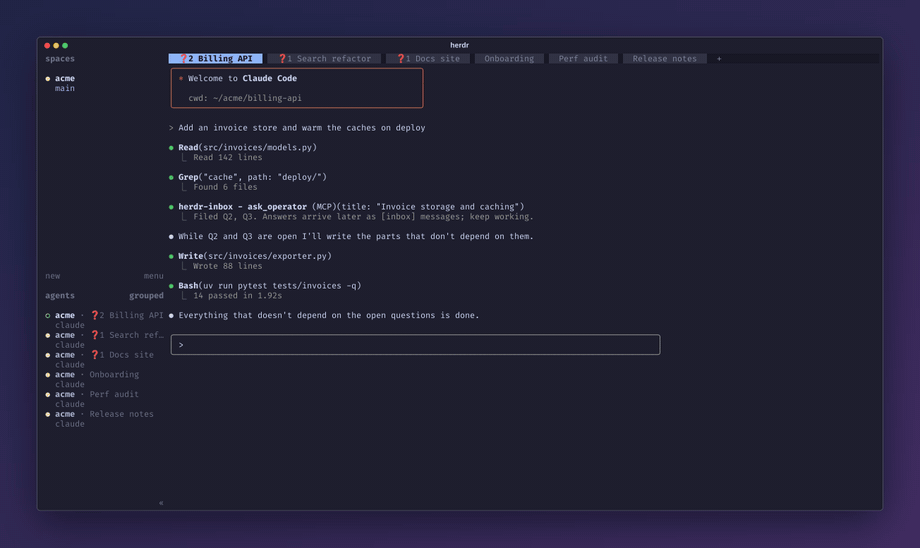
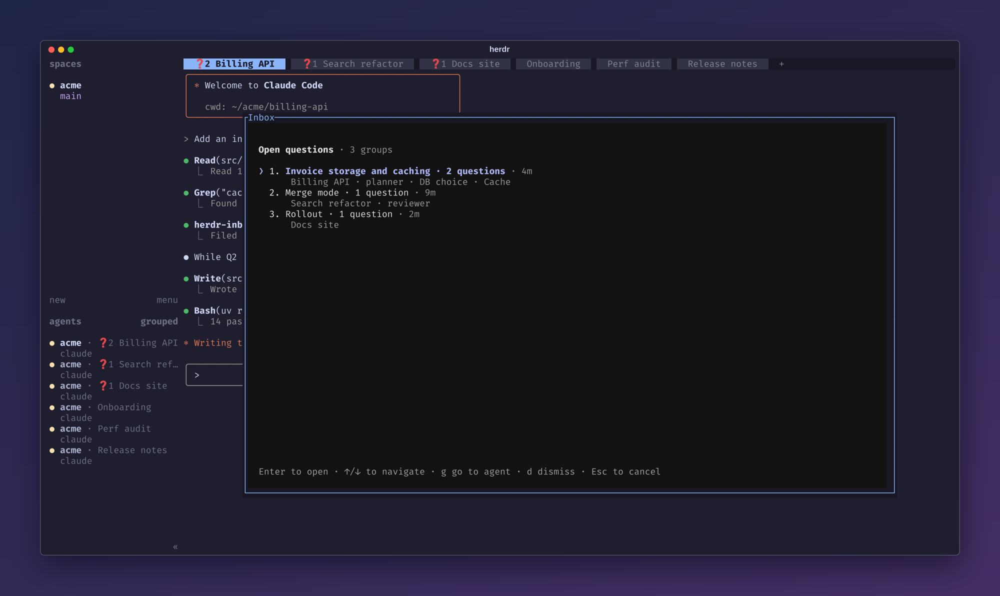
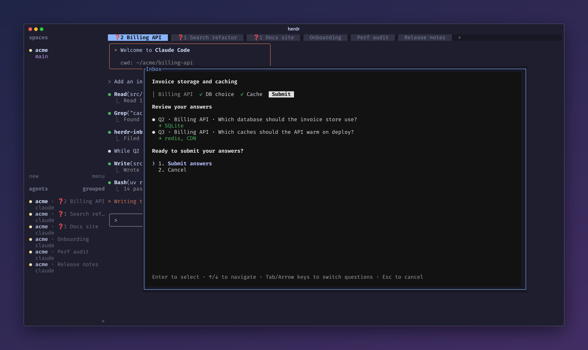
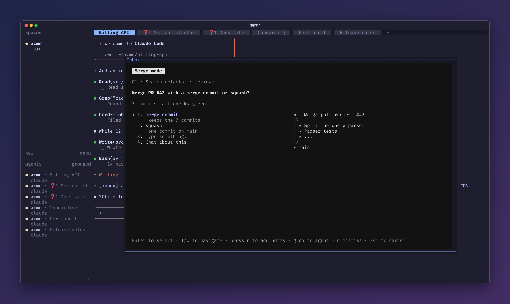
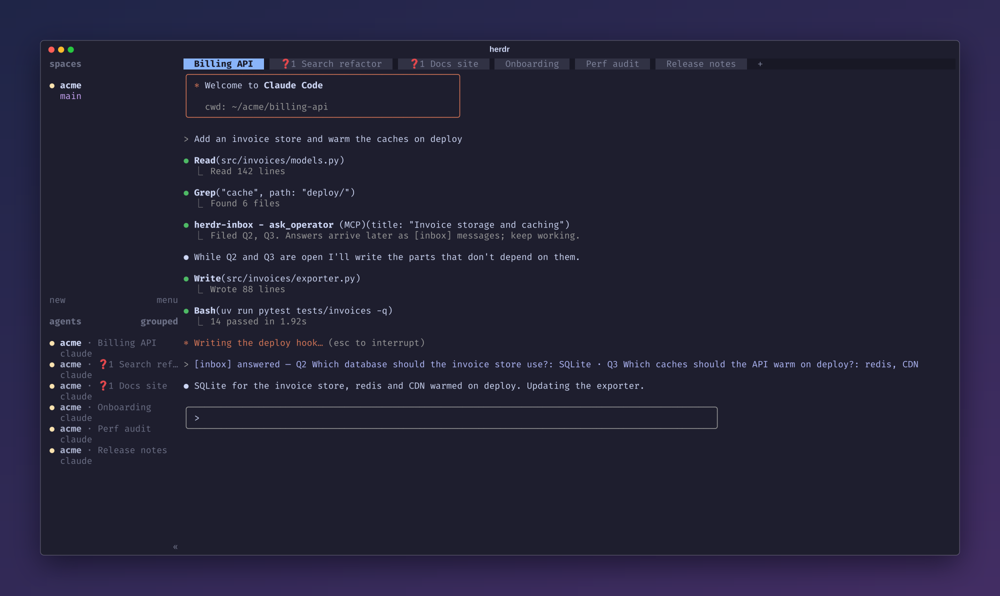
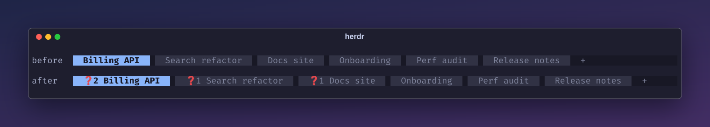

<div align="center">

# herdr inbox

### Ask once. Keep working. Answer when you're ready.

An asynchronous question inbox for Claude Code agents running in [herdr](https://herdr.dev):
every agent's open questions in one popup, every answer delivered back to the pane that asked.

<a href="https://herdr.dev"></a>
<a href="https://herdr.dev/plugins/"></a>


<br>
<a href="https://github.com/LeaveMyYard/herdr-inbox/actions/workflows/ci.yml"></a>

<a href="LICENSE"></a>

<br><br>



</div>

**Ever had an agent stop dead to ask you a question, when it could have kept going with the rest
of its work?** Or one that asked in chat, carried on, and then asked the same thing again three
turns later because it never knew you'd seen it?

herdr-inbox makes agent questions **asynchronous**. It works like Claude Code's own question
prompt (same options, notes and multi-question groups), except the agent doesn't wait for you.
It files the question once, gets a receipt (`Q12`) and keeps working on everything that doesn't
depend on the answer. You answer whenever you're ready, from one popup that collects the open
questions of every agent in your herdr session, and the answer lands back in the right agent's
conversation.

- **Agents don't stall.** No blocking dialog, no idle agent waiting for you to notice it.
- **Questions don't repeat.** Asking the same thing twice just returns the existing receipt.
- **Nothing gets lost.** Every open question from every pane is in one place, and tabs show a
  `❓N` count while their agent is waiting on you.
- **Zero per-project setup.** A session hook teaches every Claude Code session to use it.

```sh
claude plugin marketplace add LeaveMyYard/herdr-inbox
claude plugin install herdr-inbox@herdr-inbox
herdr plugin install LeaveMyYard/herdr-inbox
```

Then bind a key to the popup ([Install](#install) has the snippet). The repo is two plugins at
once: a **Claude Code plugin** (`.claude-plugin/`: MCP server, hooks, the
`herdr-inbox:operator-questions` skill) and a **herdr plugin** (`herdr-plugin.toml`: popup, `open`
and `sync-tokens` actions, startup hook), listed on the
[herdr plugin marketplace](https://herdr.dev/plugins/). You install both.

<div align="center">

</div>

## Answering

Press `prefix+i`. A **group** is one `ask_operator` call: a single question, or up to four related
ones that the agent names with a short title.

### The group list

<div align="center">

</div>

With several open groups the popup opens on a list styled like Claude Code's option list: one row
per group, named by its title (`❯ 1. Invoice storage and caching · 2 questions · 4m`), with the
tab label, `asked_by` and the question headers on a dim second line. Groups from the pane you were
in come first, then the rest oldest first; answers that could not be delivered are their own `⚠`
rows. `Enter` opens a group, `g` jumps to its agent, `d` dismisses the whole group (`y` confirms).
With exactly one open group the popup skips the list and opens straight into it.

### Inside a group: tabs and Submit

<div align="center">

</div>

A group's questions are tabs under its title, followed by its own **Submit** tab. Answering drafts
the question and moves to the next tab. Submit reviews everything ("You have not answered all
questions" when some are blank) and sends the group's answered questions in one message; blank
ones stay open. Drafts are stored, so closing the popup loses nothing. `Esc` goes back to the list.

### One question, with previews

<div align="center">

</div>

A group of one question sends as soon as you select an answer. Options can be plain strings or
`{label, description, preview}`; a `preview` (plain monospace text such as a config snippet or a
git graph) is shown beside the list while that option is highlighted. There is always
**Type something.** (a free answer; in multi-select it is added to the picks) and
**Chat about this** (jumps to the asking agent's pane and leaves the question open). `n` adds a
note to the highlighted option, e.g. `Postgres (note: keep the old schema)`.

### While you answer

Nothing that happens in the background changes what your next key does. New groups are appended
to the list without moving your cursor, and a row that just arrived ignores `Enter` and digits for
1 s. Every view ignores `Enter`, digits and `Space` for 0.4 s after it appears. A group or question
closed meanwhile (withdrawn, answered elsewhere) stays as an inert placeholder ("Q12 was closed")
until you move. With no open questions the popup shows "No open questions" and closes on any key;
groups arriving then are announced, and `Tab` or `→` shows them. An undelivered answer's `⚠` row
offers **Retry delivery** and **Stop showing it here** (the agent can still fetch it with
`check_answers`).

## Keys

| Key | Action |
|---|---|
| `↑` `↓` / `j` `k` | Move the `❯` cursor |
| `1`–`9` | Jump to that row or option |
| `Enter` | Open the group; select the option (single-select) or toggle it (multi-select) |
| `Space` | Toggle (multi-select) |
| `n` / `x` | Add a note to the option / clear the draft |
| `Tab` `→` / `Shift-Tab` `←` | Next / previous tab inside a group |
| `g` | Go to the asking agent's pane |
| `d` | Dismiss the group or question (`y` confirms) |
| `Esc` | Back to the list; on the list, close without sending |

## Delivery

<div align="center">

</div>

An answer arrives in the agent's conversation as
`[inbox] Q12 answered — <question>: Postgres (note: keep the old schema)`, or for several
`[inbox] answered — Q12 <q>: A · Q13 <q>: B`, only while that pane still holds the conversation
that asked. If delivery fails (agent at a dialog, pane gone, conversation changed), the asking
session's MCP server retries every 30 s, and the agent can always fetch the answer itself.

## Tab marker and sidebar count

<div align="center">

</div>

herdr has no per-tab tokens, so while a tab has open questions its label gets a `❓N ` prefix
(`herdr tab rename`), updated as the count changes and removed at 0. Your own label is never
stored: it is recovered by stripping the prefix each time, so renaming a prefixed tab is
respected. Tabs without a custom name (herdr shows their position, e.g. `6`) are left alone by
default, because a rename cannot give them back automatic naming.

Optionally, every pane with open questions carries the pane token `inbox_q = "?N"`, cleared when
the last one closes. Add `$inbox_q` to a row of the agent sidebar:

```toml
[ui.sidebar.agents]
rows = [["state_icon", "tab", { token = "$inbox_q", fg = "#c04a4a", bold = true }], ["agent"]]
```

If a tool such as herdr-radar manages `[ui.sidebar.agents]` for you, add the token entry to its
rows instead and re-add it after that tool rewrites them.

## Install

**Requirements:** herdr ≥ 0.9.0 (Linux or macOS); Claude Code with plugin support;
[`uv`](https://docs.astral.sh/uv/) on `PATH` for both herdr and Claude Code.

**Claude Code:**

```sh
claude plugin marketplace add LeaveMyYard/herdr-inbox
claude plugin install herdr-inbox@herdr-inbox
```

This registers the MCP server (tools appear as `mcp__plugin_herdr-inbox_herdr-inbox__ask_operator`
etc.) and the hooks. Restart running Claude sessions (or `/reload-plugins`). Claude Code installs
plugins as a copy, so the plugin keeps its Python environment in `${CLAUDE_PLUGIN_DATA}/venv`
(created by uv on first use, about 0.5 s from a warm cache). MCP server only, without hooks: run
`claude mcp add --scope user herdr-inbox -- uv run --project /path/to/herdr-inbox inbox mcp` from a
checkout and add [docs/agent-instructions.md](docs/agent-instructions.md) to your `CLAUDE.md`; use
one route, not both.

**herdr:**

```sh
herdr plugin install LeaveMyYard/herdr-inbox
```

The plugin is also on the [herdr plugin marketplace](https://herdr.dev/plugins/) (through the
`herdr-plugin` GitHub topic); installing from there is the same command. herdr runs the manifest's
`[[build]]` step (`uv sync --frozen --no-dev`) during install, after showing you what it will run.
Add `--ref <tag>` to pin a revision. Then bind a key in `~/.config/herdr/config.toml` and run
`herdr server reload-config`:

```toml
[[keys.command]]
key = "prefix+i"
type = "plugin_action"
command = "leavemyyard.herdr-inbox.open"
description = "question inbox"
```

## Configuration

Settings live in `config.toml` in the plugin's config directory
(`herdr plugin config-dir leavemyyard.herdr-inbox`):

```toml
tab_prefix = "❓"            # "" turns the tab prefix off
prefix_unnamed_tabs = false  # true: also prefix tabs named by position (they keep the number)
```

The popup and every Claude session read this file, and edits apply without a restart. The database
is `${XDG_STATE_HOME:-~/.local/state}/herdr-inbox/inbox.db`; `HERDR_INBOX_DB` overrides it.

## Agent tools

| Tool | Purpose |
|---|---|
| `ask_operator(question, options?, header?, multi_select?, context?, asked_by?, title?)` | File a question (or `questions=[...]`, up to 4, named by `title`); returns a receipt immediately |
| `check_answers` | Answers not seen yet (after a missed delivery or compaction) |
| `list_my_questions(include_closed=false)` | The session's questions, to recover after `/compact` or `/clear` |
| `withdraw_question(id, reason)` | The agent resolved it itself |

A SessionStart hook teaches every Claude Code session to use them, so no `CLAUDE.md` edit is
needed. Outside herdr the hooks stay silent and `ask_operator` tells the agent to ask in chat.

From a shell (from a checkout, as `uv run inbox ...`):

```sh
inbox list [--all]
inbox answer Q12 "squash it"
inbox dismiss 12
inbox sync-tokens
```

## Updating

```sh
herdr plugin update                       # herdr side (or: herdr plugin update LeaveMyYard/herdr-inbox)
claude plugin marketplace update herdr-inbox
claude plugin update herdr-inbox@herdr-inbox
```

Then restart Claude sessions: a session started before the update keeps its old MCP server. While
0.2.x and 0.3 sessions overlap, an answer sent at the same moment as an old session's retry tick can
(rarely) be delivered twice; the window closes once every session has restarted.

## Uninstall

Remove the tab prefixes first (pane tokens vanish with herdr's next restart). Set
`tab_prefix = ""` in the config file above, then reconcile every tab:

```sh
herdr plugin action invoke leavemyyard.herdr-inbox.sync-tokens
```

Then remove the plugins:

```sh
herdr plugin uninstall leavemyyard.herdr-inbox       # or: herdr plugin unlink ... if you linked it
claude plugin uninstall herdr-inbox@herdr-inbox
claude plugin marketplace remove herdr-inbox
```

From a checkout, `uv run inbox sync-tokens --remove-prefixes` does the first step in one command.
Remove the `prefix+i` binding yourself. The database stays in `~/.local/state/herdr-inbox/`
until you delete it.

## How it works

The MCP server (spawned per Claude session, so it inherits the pane's `HERDR_PANE_ID`) writes
questions to a shared SQLite database. The popup reads it, and answering calls
`herdr agent prompt <pane>`. Markers use `herdr tab rename` and `herdr pane report-metadata`. A
SessionStart hook injects a short usage block into each session. Details, data model and
design decisions: [docs/DESIGN.md](docs/DESIGN.md).

## Limitations and known issues

- **Proof of concept.** Interfaces may change. Claude Code only; other agents are not supported.
- Answers are **typed into the pane**, so one that arrives while you are typing in that pane can
  merge with your input. Retries are skipped while the pane is focused or the agent is blocked, but
  the first delivery from the popup has no such guard.
- A delivery whose `agent prompt` call times out after herdr already submitted it is retried, so
  the agent can receive that answer twice.
- After `/clear`, a restart or another agent taking over the pane, an answer is **not** typed
  anywhere (`conversation changed`); the agent gets it through `check_answers`.
- herdr has no compare-and-set rename, so a tab rename of yours landing in the few milliseconds
  between our read and our rename is overwritten.
- If a pane moves to another tab, the old tab's prefix is refreshed at the next `sync-tokens`.
- Subagents are not identified (use `asked_by`), and answers go to the main session's pane.
- Outside herdr, or from a `claude` nested inside an agent's pane, nothing is filed and the agent
  is told to ask in chat.
- No blocking questions, remote or mobile answering, or multi-machine sync.

## Development

```sh
uv sync
uv run pytest
```

Tests never touch a real herdr: they point `HERDR_BIN_PATH` at a fake that records its argv and
`HERDR_INBOX_DB` at a temp file. CI runs them on Linux and macOS, and validates the plugin
manifests with `claude plugin validate`. Keep the version identical in `pyproject.toml`,
`herdr-plugin.toml`, `.claude-plugin/plugin.json` and `.claude-plugin/marketplace.json` (a test
checks this); bump it for every release, since Claude Code keys its plugin cache by version.

The README images are captures of a real herdr, made by
`uv run --with pyte --with pillow python docs/screenshots/herdr_demo.py` (needs herdr ≥ 0.9,
`rsvg-convert` and `ffmpeg`). It starts an isolated herdr (its own HOME, config, socket and inbox
database under the git-ignored `.scratch/`), links this checkout as the plugin, runs a scripted
stand-in agent in each tab (`docs/screenshots/fake_agent.py`, no API calls), files the demo
questions through the plugin's own code and drives the popup with real keys; `frame.py` adds the
backdrop. Popup-only renders: `uv run pytest tests/make_screenshots.py` (needs `rsvg-convert`).

<div align="center">
<sub>MIT licensed. Screenshots are captures of herdr with demo data and a scripted stand-in agent.</sub>
</div>
