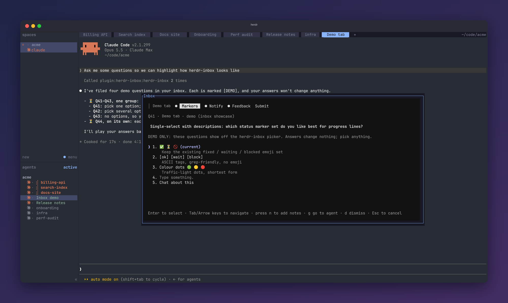

<div align="center">

# herdr inbox

### Ask once. Keep working. Answer when you're ready.

An asynchronous question inbox for Claude Code agents running in [herdr](https://herdr.dev):
every agent's open questions in one popup, every answer delivered back to the pane that asked.

<a href="https://herdr.dev"></a>
<a href="https://herdr.dev/plugins/"></a>


<br>
<a href="https://github.com/LeaveMyYard/herdr-inbox/actions/workflows/ci.yml"></a>

<a href="LICENSE"></a>

<br><br>

<a href="docs/media/herdr-demo.mp4"></a>

<sub>Click for the 36-second demo with <a href="https://github.com/LeaveMyYard/herdr-panorama">herdr-panorama</a> (MP4).</sub>

</div>

**Ever had an agent stop dead to ask you a question, when it could have kept going with the rest
of its work?** Or one that asked in chat, carried on, and then asked the same thing again three
turns later because it never knew you'd seen it?

herdr-inbox makes agent questions **asynchronous**. It works like Claude Code's own question
prompt (same options, notes and multi-question groups), except the agent doesn't wait for you.
It files the question once, gets a receipt (`Q12`) and keeps working on everything that doesn't
depend on the answer. You answer whenever you're ready, from one popup that collects the open
questions of every agent in your herdr session, and the answer lands back in the right agent's
conversation.

- **Agents don't stall.** No blocking dialog, no idle agent waiting for you to notice it.
- **Questions don't repeat.** Asking the same thing twice just returns the existing receipt.
- **Nothing gets lost.** Every open question from every pane is in one place, and tabs show a
  `❓N` count while their agent is waiting on you.
- **Zero per-project setup.** A session hook teaches every Claude Code session to use it.

```sh
claude plugin marketplace add LeaveMyYard/herdr-inbox
claude plugin install herdr-inbox@herdr-inbox
herdr plugin install LeaveMyYard/herdr-inbox
```

Then bind a key to the popup ([Install](#install) has the snippet). The repo is two plugins at
once: a **Claude Code plugin** (`.claude-plugin/`: MCP server, hooks, the
`herdr-inbox:operator-questions` skill) and a **herdr plugin** (`herdr-plugin.toml`: popup, `open`
and `sync-tokens` actions, startup hook), listed on the
[herdr plugin marketplace](https://herdr.dev/plugins/). You install both.

<div align="center">

</div>

## Works great with herdr-panorama

Running many Claude Code agents at once? [herdr-panorama](https://github.com/LeaveMyYard/herdr-panorama)
shows them all on one live screen: every orchestrator, the threads it drives and the subagents it
spawned. The two plugins know about each other. An agent that asks through the inbox gets a `?N` on
its panorama card, `a` on that card opens the inbox right on its question, and your answer goes
back to the agent, which carries on.

<div align="center">
<a href="docs/media/herdr-demo.mp4"></a>
</div>

```sh
herdr plugin install LeaveMyYard/herdr-panorama   # then bind prefix+space to leavemyyard.herdr-panorama.open
```

## Requirements

- **herdr ≥ 0.9.0** on Linux or macOS ([herdr.dev](https://herdr.dev)).
- **Claude Code** with plugin support. Hook delivery and idle wake-up were probed on 2.1.301;
  sessions whose hooks do not fire get their answers typed instead. The optional
  `herdr-inbox-ui` cards need 2.1.301+.
- **[uv](https://docs.astral.sh/uv/)** on `PATH` for both herdr and Claude Code (it brings its
  own Python 3.11+); the hooks use the system `python3` (3.11+, else uv).

## Answering

Press `prefix+i`. A **group** is one `ask_operator` call: a single question, or up to four related
ones that the agent names with a short title.

### The group list

<div align="center">

</div>

With several open groups the popup opens on a list styled like Claude Code's option list: one row
per group, named by its title (`❯ 1. Invoice storage and caching · 2 questions · 4m`), with the
tab label, `asked_by` and the question headers on a dim second line. Groups from the pane you were
in come first, then the rest oldest first; answers that could not be delivered are their own `⚠`
rows. `Enter` opens a group, `g` jumps to its agent, `d` dismisses the whole group (`y` confirms).
With exactly one open group the popup skips the list and opens straight into it.

### Inside a group: tabs and Submit

<div align="center">

</div>

A group's questions are tabs under its title, followed by its own **Submit** tab. Answering drafts
the question and moves to the next tab. Submit reviews everything ("You have not answered all
questions" when some are blank) and sends the group's answered questions in one message; blank
ones stay open. Drafts are stored, so closing the popup loses nothing. `Esc` goes back to the list.

### One question, with previews

<div align="center">

</div>

A group of one question sends as soon as you select an answer. Options can be plain strings or
`{label, description, preview}`; a `preview` (plain monospace text such as a config snippet or a
git graph) is shown beside the list while that option is highlighted. There is always
**Type something.** (a free answer; in multi-select it is added to the picks) and
**Chat about this** (jumps to the asking agent's pane and leaves the question open). `n` adds a
note to the highlighted option, e.g. `Postgres (note: keep the old schema)`.

### While you answer

Nothing that happens in the background changes what your next key does. New groups are appended
to the list without moving your cursor, and a row that just arrived ignores `Enter` and digits for
1 s. Every view ignores `Enter`, digits and `Space` for 0.4 s after it appears. A group or question
closed meanwhile (withdrawn, answered elsewhere) stays as an inert placeholder ("Q12 was closed")
until you move. With no open questions the popup shows "No open questions" and closes on any key;
groups arriving then are announced, and `Tab` or `→` shows them. An undelivered answer's `⚠` row
offers **Retry delivery** and **Stop showing it here** (the agent can still fetch it with
`check_answers`).

## Keys

| Key | Action |
|---|---|
| `↑` `↓` / `j` `k` | Move the `❯` cursor |
| `1`–`9` | Jump to that row or option |
| `Enter` | Open the group; select the option (single-select) or toggle it (multi-select) |
| `Space` | Toggle (multi-select) |
| `n` / `x` | Add a note to the option / clear the draft |
| `Tab` `→` / `Shift-Tab` `←` | Next / previous tab inside a group |
| `g` | Go to the asking agent's pane |
| `d` | Dismiss the group or question (`y` confirms); on an alert, acknowledge it |
| `Esc` | Back to the list; on the list, close without sending |

## Delivery

<div align="center">

</div>

An answer arrives in the agent's conversation as
`[inbox] Q12 answered — <question>: Postgres (note: keep the old schema)`, or for several
`[inbox] answered — Q12 <q>: A · Q13 <q>: B`, only while that pane still holds the conversation
that asked.

**How it gets there depends on the agent.**
- **An idle Claude Code session** (0.10.0) is woken with the answer without any typing. A
  background hook waits for answers after each turn and starts a new turn with the answer. It
  wakes the agent even while you are looking at its pane, without touching what you type. Each
  idle session keeps one small background process (about 12 MB of its own memory).
- **A Claude Code session that is working** gets the answer without any typing. The inbox's own
  hooks hand it over as context at its next tool batch, or when its turn ends; then the turn
  continues with the answer.
- **Other agents** (Codex etc.), **Claude sessions started before the update**, sessions whose
  hooks stopped firing, and **Send now** get it typed into the pane.

**Note on consent.** Claude Code marks an answer that arrives through its hooks as an
automated notification, not as something the user typed. Agents act on such answers as
information. But an agent may refuse to treat one as your approval for something risky, like
"deploy? yes". Ask for such confirmations in chat, as the inbox rules already say.

Either way the inbox counts an answer as seen only once the conversation transcript shows it.

If an answer can't be delivered right away, one background delivery worker retries every few
seconds. This covers an agent at a dialog, an agent busy, Claude Code's background-agents panel
having focus, or a typed answer that never showed up in the conversation. The worker serves every
pane, whichever inbox version each session runs. It starts with herdr and on demand (`inbox
worker --ensure`). It stays up while herdr reports agents, and stops after 10 idle minutes
without any.

The popup shows why an answer is waiting. If an answer is still undelivered after 5 minutes, or
runs out of tries, herdr shows a notification. The agent can always fetch it itself with
`check_answers`.

## Tab marker and sidebar count

<div align="center">

</div>

herdr has no per-tab tokens, so while a tab has open questions its label gets a `❓N ` prefix
(`herdr tab rename`), updated as the count changes and removed at 0. Your own label is never
stored: it is recovered by stripping the prefix each time, so renaming a prefixed tab is
respected. Tabs without a custom name (herdr shows their position, e.g. `6`) are left alone by
default, because a rename cannot give them back automatic naming.

Optionally, every pane with open questions carries the pane token `inbox_q = "?N"`, cleared when
the last one closes. Add `$inbox_q` to a row of the agent sidebar:

```toml
[ui.sidebar.agents]
rows = [["state_icon", "tab", { token = "$inbox_q", fg = "#c04a4a", bold = true }], ["agent"]]
```

**With [herdr-radar](https://github.com/hhdebb/herdr-radar)**, which replaces the agent rows with
its own and has no slot for other plugins' tokens yet
([hhdebb/herdr-radar#57](https://github.com/hhdebb/herdr-radar/issues/57) proposes an
`extra_tokens` setting), run the action **Inbox: show ?N in herdr-radar's sidebar**
(`herdr plugin action invoke leavemyyard.herdr-inbox.radar-sidebar`, or `inbox radar-sidebar`).
It adds the `$inbox_q` cell to each of radar's agent rows, inside radar's managed block only, and
reloads herdr's config. It runs only when you ask: radar rewrites its block on its configure
action, and the popup then shows a one-line hint to run it again (`radar_sidebar_hint = false`
turns the hint off). It leaves the file alone if it does not parse, if a row would exceed herdr's
16-token limit, or once radar's config carries `$inbox_q` in `extra_tokens` itself; a backup of
the previous file is kept as `config.toml.inbox-bak`.

## Install

See [Requirements](#requirements) first.

**Claude Code:**

```sh
claude plugin marketplace add LeaveMyYard/herdr-inbox
claude plugin install herdr-inbox@herdr-inbox
```

This registers the MCP server (tools appear as `mcp__plugin_herdr-inbox_herdr-inbox__ask_operator`
etc.) and the hooks. Restart running Claude sessions (or `/reload-plugins`). Claude Code installs
plugins as a copy, so the MCP server keeps its Python environment in
`${CLAUDE_PLUGIN_DATA}/venv-<version>` (created by uv on first use, about 0.5 s from a warm cache;
older versions' venvs are removed automatically once no server uses them; after restarting
sessions that predate 0.5.3, `inbox clean-venvs` removes their older venvs too). The hooks need only the
system `python3` (3.11+; older falls back to uv) and always exit 0. MCP server only, without hooks: run
`claude mcp add --scope user herdr-inbox -- uv run --project /path/to/herdr-inbox inbox mcp` from a
checkout and add [docs/agent-instructions.md](docs/agent-instructions.md) to your `CLAUDE.md`; use
one route, not both.

**herdr:**

```sh
herdr plugin install LeaveMyYard/herdr-inbox
```

The plugin is also on the [herdr plugin marketplace](https://herdr.dev/plugins/) (through the
`herdr-plugin` GitHub topic); installing from there is the same command. herdr runs the manifest's
`[[build]]` step (`uv sync --frozen --no-dev`) during install, after showing you what it will run.
Add `--ref <tag>` to pin a revision. Then bind a key in `~/.config/herdr/config.toml` and run
`herdr server reload-config`:

```toml
[[keys.command]]
key = "prefix+i"
type = "plugin_action"
command = "leavemyyard.herdr-inbox.open"
description = "question inbox"
```

### Transcript cards (optional)

`herdr-inbox-ui` is a separate plugin in the same marketplace that draws herdr-inbox in the
Claude Code transcript: `ask_operator` as a card with the title, questions, options, `asked_by`
and the filed Q ids; `alert_operator` as a card coloured by severity (info cyan, warning yellow,
urgent red); `check_answers`, `list_my_questions` and the withdraw tools as one dim line (a folded run of
inbox calls is unfolded when it asks or alerts, so the cards show); and an
arriving `[inbox]` answer (single, batch or pasted) as a green block listing each Q id with its
answer, plus a toast. ctrl+o shows the raw message. It changes only what is drawn, never what
the model reads. It uses Claude Code's early-access mods API (2.1.301+; terminal and desktop
draw it, other surfaces keep the plain rows), which is why it is not part of `herdr-inbox`:

```sh
claude plugin install herdr-inbox-ui@herdr-inbox
```

## Configuration

Settings live in `config.toml` in the plugin's config directory
(`herdr plugin config-dir leavemyyard.herdr-inbox`):

```toml
tab_prefix = "❓"            # "" turns the tab prefix off
prefix_unnamed_tabs = false  # true: also prefix tabs named by position (they keep the number)
radar_sidebar_hint = true    # false: no popup hint when herdr-radar's rows lack $inbox_q
```

The popup and every Claude session read this file, and edits apply without a restart. The database
is `${XDG_STATE_HOME:-~/.local/state}/herdr-inbox/inbox.db`; `HERDR_INBOX_DB` overrides it.

## Agent tools

| Tool | Purpose |
|---|---|
| `ask_operator(question, options?, header?, multi_select?, context?, asked_by?, title?)` | File a question (or `questions=[...]`, up to 4, named by `title`); returns a receipt immediately |
| `check_answers` | Answers not seen yet (after a missed delivery or compaction) |
| `list_my_questions(include_closed=false)` | The session's questions, to recover after `/compact` or `/clear` |
| `withdraw_question(id, reason)` | The agent resolved it itself |
| `alert_operator(title, message?, severity?, asked_by?)` | "Please check X": no answer expected; shows as an alert until acknowledged |
| `withdraw_alert(id)` | The issue resolved itself |

### Alerts

An alert (`A7`) is something the operator should check, with no answer expected. It heads the
popup list (`⚑`, most severe first, unnumbered: digits and Enter keep acting on your
questions exactly as before), raises a notification and counts in the ❓N badge until
acknowledged with `d` (↑/↓ to reach it). The agent learns of the acknowledgement
through `check_answers`; nothing is typed into its pane.

The delivery worker also raises an alert by itself (`⏸ <tab> is waiting for you`) for an agent
herdr reports as `blocked` for 15 s — stuck at a permission, AskUserQuestion or plan prompt,
where it cannot call any tool. A deliberate `g` (a pause after your last key) goes to it,
never Enter or a digit; the alert clears when the prompt is answered.
The inbox never types into that pane.

A SessionStart hook teaches every Claude Code session to use them, so no `CLAUDE.md` edit is
needed. Outside herdr the hooks stay silent and `ask_operator` tells the agent to ask in chat.

From a shell (from a checkout, as `uv run inbox ...`):

```sh
inbox list [--all]
inbox answer Q12 "squash it"
inbox dismiss 12
inbox sync-tokens
inbox radar-sidebar [--remove]   # $inbox_q in herdr-radar's sidebar rows (on demand)
```

## Opening the inbox from another plugin

Another plugin (or a script) can open the popup straight on one question or group:

```sh
root=$(herdr plugin list --json | jq -r '.result.plugins[] | select(.plugin_id == "leavemyyard.herdr-inbox") | .plugin_root')
uv run --quiet --frozen --no-dev --project "$root" inbox open --question Q12   # or:
#   inbox open --group 7            the group (one ask_operator call)
#   inbox open --pane w6:p3A        that pane's oldest open group
#   inbox open --session <id>       that Claude session's oldest open group
```

**Run it only on an explicit operator action** (a key binding, a click), never from an event or
a timer. A popup takes all keyboard input, so one that appears under the operator's typing would
swallow their keys.

A caller whose open always comes from an explicit operator key or click (herdr-panorama's `a`,
say) can pass `--no-hold`. The popup then opens like a normal one: its views arm for 0.4 s, then
Enter works. Pass `--no-hold` only in that case.

Without it, as a second guard, a deep-linked popup sends nothing until the operator presses Tab or →, at
least half a second after it appeared. ↑/↓ don't count, since they are what shell history under
the popup would send. Until then it shows "Opened from another plugin — press Tab or → to start
answering", and Enter and digits do nothing.

How it works:

- `herdr plugin pane open` cannot pass arguments to the popup. So `inbox open` writes a one-shot
  request (`open-request.json` next to the database: target, time and nonce, written atomically,
  newest wins).
- It then opens the inbox's own popup. The plugin id and root are fixed to the inbox's own, never
  the calling plugin's.
- It hands the request's nonce to that popup. Only that popup takes the request, and only within
  5 s; a popup opened by hand ignores it.
- The popup opens the target group on the target question, with the list behind it (Esc goes back
  to the list). If the target is no longer open, it shows the list with a one-line notice.
- If the popup is already open, `inbox open` exits with code 3 and the message "the inbox popup is
  already open", and writes nothing.
- `--question` takes `Qn` or `n` and `--group` takes a number; anything else is a usage error
  (exit 2).

## Remote machines

Agents on a saved herdr SSH machine (`herdr machine list`) can ask you too.

1. Install the inbox there once, from this machine:
   ```sh
   inbox remote install <machine>     # later: inbox remote upgrade <machine>
   ```
   This needs key-based ssh; it never prompts for a password.
2. Restart the Claude sessions on that machine.

Their questions then show up in this popup as `<machine>:Q12`. Answers are queued here and
sent by the delivery worker, and the remote's own inbox types them into its agent. Settings
in the inbox `config.toml`: `remote_sync_seconds = 5` and `remote_answer_expiry_hours = 12`.
Details: [docs/REMOTE.md](docs/REMOTE.md).

## Updating

```sh
herdr plugin update                       # herdr side (or: herdr plugin update LeaveMyYard/herdr-inbox)
claude plugin marketplace update herdr-inbox
claude plugin update herdr-inbox@herdr-inbox
```

Then restart Claude sessions: a session started before the update keeps its old MCP server. While
0.2.x and 0.3 sessions overlap, an answer sent at the same moment as an old session's retry tick can
(rarely) be delivered twice; the window closes once every session has restarted.

## Uninstall

Remove the tab prefixes first (pane tokens vanish with herdr's next restart). Set
`tab_prefix = ""` in the config file above, then reconcile every tab:

```sh
herdr plugin action invoke leavemyyard.herdr-inbox.sync-tokens
```

Then remove the plugins:

```sh
herdr plugin uninstall leavemyyard.herdr-inbox       # or: herdr plugin unlink ... if you linked it
claude plugin uninstall herdr-inbox@herdr-inbox
claude plugin marketplace remove herdr-inbox
```

From a checkout, `uv run inbox sync-tokens --remove-prefixes` does the first step in one command.
If you added `$inbox_q` to herdr-radar's rows, take it out first with `inbox radar-sidebar --remove`.
Remove the `prefix+i` binding yourself. The database stays in `~/.local/state/herdr-inbox/`
until you delete it.

## How it works

The MCP server (spawned per Claude session, so it inherits the pane's `HERDR_PANE_ID`) writes
questions to a shared SQLite database. The popup reads it, and answering calls
`herdr agent prompt <pane>`. Markers use `herdr tab rename` and `herdr pane report-metadata`. A
SessionStart hook injects a short usage block into each session. Details, data model and
design decisions: [docs/DESIGN.md](docs/DESIGN.md).

## FAQ and troubleshooting

**`prefix+i` does nothing.** The key is yours to bind (see [Install](#install)); after editing
`config.toml` run `herdr server reload-config`. `herdr plugin list` should show
`leavemyyard.herdr-inbox` enabled, and `herdr plugin log` shows its action and startup logs,
including a missing `uv` on herdr's `PATH`.

**My agents still ask in chat.** Restart the Claude Code sessions (or `/reload-plugins`) after
installing: the MCP server and the session hook load at session start. Outside herdr, or in a
`claude` nested inside an agent's pane, the tool tells the agent to ask in chat on purpose.

**An answer did not arrive.** The popup shows it as a `⚠ Q12 not delivered` row with
**Retry delivery**; `inbox list --all` from a checkout shows every question's state. The agent
can always fetch its answers itself with `check_answers`.

**Tabs still show `❓N` after I uninstalled.** Run the `sync-tokens` step from
[Uninstall](#uninstall) before removing the plugin, or rename the tabs back by hand.

**Does anything leave my machine?** The plugin sends your questions and answers nowhere: they
live in a local SQLite database (`~/.local/state/herdr-inbox/inbox.db`), and the plugin talks only
to your herdr session. The one exception is [remote machines](#remote-machines), if you set them
up: then they travel over your own SSH to those machines. An answer is delivered into the asking
agent's conversation, which Claude Code sends to its model as it does with everything you type.
Installing and updating download the plugin from GitHub and its Python dependencies from PyPI
(through uv).

**Codex, pi or other agents?** Not yet: the MCP tool and the hooks target Claude Code.

## Limitations and known issues

- **Proof of concept.** Interfaces may change. Claude Code only; other agents are not supported.
- Answers are **typed into the pane**, so one that arrives while you are typing in that pane can
  merge with your input. Retries are skipped while the pane is focused or the agent is blocked, but
  the first delivery from the popup has no such guard.
- A delivery whose `agent prompt` call times out after herdr already submitted it is retried, so
  the agent can receive that answer twice.
- After `/clear`, a restart or another agent taking over the pane, an answer is **not** typed
  anywhere (`conversation changed`); the agent gets it through `check_answers`.
- herdr has no compare-and-set rename, so a tab rename of yours landing in the few milliseconds
  between our read and our rename is overwritten.
- If a pane moves to another tab, the old tab's prefix is refreshed at the next `sync-tokens`.
- Subagents are not identified (use `asked_by`), and answers go to the main session's pane.
- Outside herdr, or from a `claude` nested inside an agent's pane, nothing is filed and the agent
  is told to ask in chat.
- No blocking questions, remote or mobile answering, or multi-machine sync.

## Development

```sh
uv sync
uv run pytest
claude plugin validate --strict plugins/herdr-inbox-ui
claude plugin test plugins/herdr-inbox-ui   # the transcript-cards mod (terminal + desktop)
```

Tests never touch a real herdr: they point `HERDR_BIN_PATH` at a fake that records its argv and
`HERDR_INBOX_DB` at a temp file. CI runs them on Linux and macOS, and validates the plugin
manifests with `claude plugin validate`. Keep the version identical in `pyproject.toml`,
`herdr-plugin.toml`, `.claude-plugin/plugin.json` and `.claude-plugin/marketplace.json` (a test
checks this); bump it for every release, since Claude Code keys its plugin cache by version.

The README images are captures of a real herdr, made by
`uv run --with pyte --with pillow python docs/screenshots/herdr_demo.py` (needs herdr ≥ 0.9,
`rsvg-convert` and `ffmpeg`). It starts an isolated herdr (its own HOME, config, socket and inbox
database under the git-ignored `.scratch/`), links this checkout as the plugin, runs a scripted
stand-in agent in each tab (`docs/screenshots/fake_agent.py`, no API calls), files the demo
questions through the plugin's own code and drives the popup with real keys; `frame.py` adds the
backdrop. Popup-only renders: `uv run pytest tests/make_screenshots.py` (needs `rsvg-convert`).

<div align="center">
<sub>MIT licensed. Screenshots are captures of herdr with demo data and a scripted stand-in agent.</sub>
</div>
